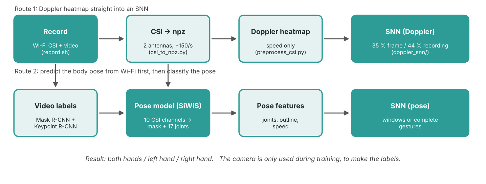

# Gesture recognition from Wi-Fi signals (CSI → body pose → spiking neural network)

| | |
|---|---|
| **Author** | Vansh Dokania |
| **Roll number** | 2024600 |
| **College** | IIIT Delhi (IIITD), ECE |
| **Project** | BTP (B.Tech project) |
| **Supervisor** | Dr. Pragma Kar |
| **PhD mentor** | Vijay Kumar |

This repository contains all the code I wrote for my BTP at IIIT Delhi.
The question was simple: **can a Wi-Fi router and a laptop tell which hand a person is raising, without any camera?**

I record three gestures, each repeated about 48 times per recording:

| code | gesture |
|------|---------|
| `bhu` | both hands up |
| `lhu` | left hand up |
| `rhu` | right hand up |

The only input to the final classifier is the Wi-Fi channel state information (CSI). A camera is used during recording,
but only to create training labels. It is never an input of the final model.

> The code was written during the project and collected afterwards. It runs end to end on my setup
> (Intel AX200 card with PicoScenes, EMEET webcam, one GPU server), but it is research code, not a polished package.
> Section [Known limitations](#known-limitations) lists what to keep in mind.

---

## 1. The story in five steps

1. **Direct approach: Doppler heatmaps → SNN.** I turned the CSI into a Doppler heatmap (how fast things move) and fed it
   straight to a spiking neural network (SNN). Tested on a person the model had never seen (train on three people, test on
   the fourth), it reached only **35 % per frame / 44 % per recording** (chance is 33 %). The heatmap shows speed, not
   position, and raising the left or the right hand look almost the same in speed.
2. **Add position: predict the body pose from Wi-Fi.** I used the SiWiS model (the repository I was given for this project) to predict a body
   outline and 17 joints from the CSI. The labels for this come from video, using Mask R-CNN and Keypoint R-CNN.
   The SNN then reads the *predicted pose* over time (outline, joints, and their speed).
3. **Cross-person test.** Still weak (about 43–54 %). A control run with poses taken from the *video* gave 75 % / 80 %, so the
   SNN is fine and the **pose prediction for a new person** is the bottleneck. Wi-Fi reflections depend strongly on height,
   build and style, so a model trained on other people does not transfer.
4. **Within-person test.** Train and test on the same person (first 80 % of each recording for training, last 20 % for testing).
   On fixed 5-second windows the SNN reaches **77 % per window / 81 % per recording** with arm joints and speed.
5. **Complete gestures.** A window can cut a gesture in half, so I cut each recording into single gestures using the video
   (the hand-height curve of the person), and classify one complete gesture at a time. Result: **about 89 %** on 269 test
   gestures. A control with video poses reaches 99–100 %.

The flowcharts of the whole pipeline are in `docs/images/` (see also [docs/workflow.md](docs/workflow.md)).



---

## 2. Repository layout

```
.
├── collection/          recording the data (laptop)
│   ├── record.sh            one trial: PicoScenes (CSI) + webcam video, one folder per trial
│   └── csi_check.sh         debugging helper when PicoScenes writes no .csi file
├── csi_tools/           from raw .csi to Doppler heatmap
│   ├── csi_to_npz.py        PicoScenes .csi  ->  .npz (two antennas, ~150 packets/s)
│   ├── preprocess_csi.py    double ratio, cleaning, resampling, Doppler heatmap
│   └── csi_video_sync.py    plays the heatmap next to the video (to check the time alignment by eye)
├── doppler_snn/         experiment 1: Doppler heatmap -> SNN (cross-person)
│   ├── make_dataset.py      raw recordings -> labelled 1 s frames
│   ├── train_snn.py         the SNN (train / validate / test split by person)
│   └── label_frames.py      optional: active / still labelling from the motion curve
├── siwis_pose/          experiments 2-4: Wi-Fi -> pose -> SNN
│   ├── prepare_percom.py    video -> pose labels (Mask R-CNN + Keypoint R-CNN), CSI -> features
│   ├── percom_common.py     shared helpers (CSI features, video decoding, metrics, glue to the SiWiS code)
│   ├── train_percom.py      earlier pose model (2 channels, repository loss)
│   ├── train_percom_v2.py   final pose model (10 channels, balanced loss, AdamW)
│   ├── pose_snn.py          SNN on the predicted pose, fixed 5 s windows (cross-person)
│   ├── within_pipeline.py   within-person pose model + SNN on fixed 5 s windows
│   ├── video_segments.py    cuts recordings into single gestures using the video
│   └── segment_pipeline.py  within-person pose model + SNN on complete gestures (final result)
├── tools/               small helpers and side experiments
│   ├── label_check.py       sanity check of the video labels
│   ├── pose_video.py        video of the pose predicted from Wi-Fi
│   └── hand_state.py        side experiment: which hand is up, with gradient boosting on signal features
├── legacy/
│   └── find_segments.py     first version of the gesture cutter (replaced by video_segments.py)
├── scripts/             shell commands that chain everything (see section 5)
├── docs/                workflow, settings and results in detail, flowcharts
├── requirements.txt
└── README.md
```

Not included in this repository: the recordings (too large and contain people), and the instructor's SiWiS repository.
The latter is cloned by `scripts/setup_siwis.sh` (see below). I did not modify it.

---

## 3. Setup

### What you need
* **Recording (laptop):** a laptop with an Intel AX200 Wi-Fi card, [PicoScenes](https://ps.zpj.io) installed, a 5 GHz router,
  a USB webcam, `ffmpeg` and `v4l-utils`. I used a TP-Link router on a 5 GHz channel (carrier about 5.775 GHz), the AX200 with two antennas, and
  an EMEET SmartCam S600 (1080p, 30 fps).
* **CSI conversion (laptop):** the PicoScenes Python toolbox in its own virtual environment. Only this environment can read `.csi` files.
* **Training (GPU server):** a recent Python 3, PyTorch and torchvision. I used a server with 4 × H200 and started jobs through a
  `gpurun` wrapper inside `tmux`. Everything also runs on a normal machine, just slower. Set `RUN=` (empty) to skip the wrapper.

### Install
```bash
git clone <this repository>
cd <this repository>
pip install -r requirements.txt            # on the laptop and on the server
bash scripts/setup_siwis.sh                # server only: clones the SiWiS repo and copies my scripts into it
```

All folders are set in `scripts/env.sh` (default root is `~/percom`). You can override every one of them from the shell,
for example `SSD="/media/me/Disk/percom" bash scripts/run_doppler.sh`.

### Camera and router names
`collection/record.sh` has the camera path (`/dev/v4l/by-id/...`) and the router IP (`192.168.0.1`) in its first lines.
Change both for your own setup (`ls -l /dev/v4l/by-id/` shows your camera).

---

## 4. Data layout

Every trial that `record.sh` makes is a folder `experiment_<date>_<time>/` with
`video.mp4`, `timing.txt` (start times of CSI and video), one or more `rx_*.csi` files and some logs.
I copy these folders to an SSD in this structure:

```
<SSD>/percom/
├── BHU/BHU_S1_<Person>/   video.mp4  timing.txt  activity.txt  rx_xxxx.csi
├── BHU/BHU_S2_<Person>/
├── LHU/LHU_S1_<Person>/
└── RHU/...
```

The folder name `<ACT>_S<session>_<Person>` is read by the code. In total there are 36 recordings of 4 people
(35 with a usable video) for the final experiments. Two more people (Divij and Nikita) were recorded as well, but they are not part of the experiments in the report
and are excluded by default (`--exclude`). In the report the four people are called P1–P4.

---

## 5. How to run: the workflow, step by step

Every step below has a ready script in `scripts/`. They only call the Python files with the settings I used, so read them
as the documentation of the exact commands.

| step | where | what | command |
|------|-------|------|---------|
| 0 | laptop | find the Wi-Fi channel, check that CSI arrives | `bash collection/csi_check.sh` |
| 1 | laptop | record a trial (CSI + video) | `bash collection/record.sh` |
| 2 | laptop | (new person) copy and convert their recordings | `PERSON=Nikita bash scripts/add_person_laptop.sh` |
| 3 | laptop | shrink videos and send them to the server | `SERVER=user@gpu-server bash scripts/shrink_videos.sh` |
| 4 | laptop | Doppler experiment | `bash scripts/run_doppler.sh` |
| 5 | server | prepare pose labels and CSI features | `bash scripts/run_pose_prepare.sh` |
| 6 | server | cross-person pose + SNN, control | `bash scripts/run_cross_person.sh` |
| 7 | server | within-person pose + SNN on 5 s windows | `bash scripts/run_within_windows.sh` |
| 8 | server | within-person, complete gestures (final result) | `bash scripts/run_segments.sh` |

### Step 1: recording
`record.sh` starts PicoScenes at t = 0 and the webcam at t = 10 s, and pings the router every 2 ms so that packets (and therefore
CSI) keep arriving. Press `Ctrl+C` once to stop. It first finalises the video, then PicoScenes, and writes `timing.txt`
with both start times. Put the gesture name in `activity.txt` of the trial folder (`echo lhu > activity.txt`).
Each recording contains about 48 repetitions of one gesture.

### Step 2: from `.csi` to `.npz` and Doppler
```bash
python csi_tools/csi_to_npz.py ~/percom/experiment_* --out ~/percom/npz        # PicoScenes environment
python csi_tools/preprocess_csi.py --input ~/percom/npz --output ~/percom/output
```
`csi_to_npz.py` keeps the two receive antennas of the same transmitted stream and about 150 packets per second.
`preprocess_csi.py` divides antenna A by antenna B per tone (this cancels most hardware noise), divides neighbouring tones
(removes leftover offsets), clips values above 5× the typical level, resamples to an even 100 Hz grid, and takes an FFT over
0.5 s Hann windows with the static part removed. 1 Hz of Doppler is about 0.10 m/s at 5.775 GHz.
`csi_video_sync.py` produces a video with the heatmap next to the camera view.

### Step 4: Doppler → SNN
`doppler_snn/make_dataset.py` converts and preprocesses every recording and cuts 1 s frames every 0.5 s.
`doppler_snn/train_snn.py --mode loso` trains the SNN with every person as the test person once.

### Step 5: pose labels and CSI features
`siwis_pose/prepare_percom.py` decodes the video at 2 frames per second, runs Mask R-CNN (body outline, 48 × 64) and
Keypoint R-CNN (17 joints, drawn as small Gaussian dots on 48 × 64 heatmaps), and stores the CSI as a feature sequence with 150 samples per second.
For every labelled frame the model gets the 1.7 s of CSI (255 samples) that **end** at that frame, so no future signal is used.
Both networks are pretrained on COCO and are used without extra training. The video is only needed during training.

### Step 6: cross-person experiment
* `train_percom.py` is the first pose model (signal-strength spread only, 2 channels, the repository's loss).
* `train_percom_v2.py` is the final one: all 10 channels, balanced loss and AdamW. The 10 channels are the spread and the
  log level of both antennas (2 + 2), the phase difference between antennas, the estimated angle of arrival, its speed and its
  spread, and the speed of the signal level of both antennas.
* `pose_snn.py` reads the predicted poses and classifies windows of 10 frames (5 s). It can use the outline, the arm joints or both,
  with or without speed (frame-to-frame change), and `--source gt` is the control with poses from the video.

### Step 7 and 8: within person
`within_pipeline.py` and `segment_pipeline.py` train one model per person on the first 80 % of their data. The training poses for the SNN
are *out-of-fold* predictions (4 folds), so the SNN sees the same kind of imperfect poses during training and test.
In the final version (`segment_pipeline.py`) the data is split by whole gestures, with one gesture dropped between train and test, and even the
statistics used for the input (z-scores, angle offset) only use data from before the first test window.
`video_segments.py` creates the cuts: for every video frame the height of the hand above the elbow, relative to the torso,
forms a curve; each peak is one gesture and the valleys on both sides are the start and the end.
**Check the plots** it writes before you copy `segments_ai.json` to `segments.json`.

---

## 6. Settings (as in the report)

Short version. All details are in [docs/settings.md](docs/settings.md).

| | Doppler SNN | Pose SNN (windows) | Pose SNN (complete gestures) |
|---|---|---|---|
| input | 1 s of Doppler heatmap, 100 steps of 10 ms, ±40 Hz, −35…0 dB → 0…1 | 10 frames (5 s), one step per frame | one gesture (~2.5 s), one step per label frame (0.5 s) |
| layers | 256 → 128 → 3 | 256 → 128 → 3 | 256 → 128 → 3 |
| neuron | decay 0.9, threshold 1.0, soft reset | same | same |
| surrogate gradient | fast sigmoid, slope 25 | fast sigmoid, slope 10 | fast sigmoid, slope 10 |
| dropout | 0.3 | none | 0.3 on the input |
| optimiser | AdamW, lr 2e-3, weight decay 1e-3, cosine | Adam, lr 2e-3 | Adam, lr 1e-3, weight decay 1e-4, clip 1.0 |
| batch / epochs | 64 / 40 | 64 / 40 | 16 / 60 |
| loss | cross-entropy | class-weighted cross-entropy | class-weighted cross-entropy |
| augmentation | small gain change and noise | none | trim ≤ 2 frames at each end, noise σ = 0.05 |

Pose model (SiWiS): mask resolution 48 × 64, 17 joint heatmaps, input window 1.7 s (255 samples at 150 Hz), batch size 16.
Earlier model: 2 channels, repository loss, Adam, 50 epochs. Final model: 10 channels, mask loss / pixels + 500 × joint loss,
AdamW lr 3e-4, cosine decay, gradient clipping 1.0, 80 epochs (60 epochs in the within-person runs).

---

## 7. Results

| experiment | result |
|---|---|
| Doppler heatmap → SNN, new person | 35 % per frame, 44 % per recording (chance 33 %) |
| Pose quality, new person (outline score / wrists found) | earlier model 0.35 / 9 %, final model 0.42 / 38 %, mean-pose baseline 0.40 / 32 % |
| Cross-person SNN on predicted poses (window / recording) | outline 34 / 34 %, joints + speed 43 / 54 %, outline + speed 45 / 43 %, outline + joints + speed 43 / 46 % |
| Control: poses from video (window / recording) | 67 / 71 % without speed, 75 / 80 % with speed |
| Within person, 5 s windows (window / recording) | joints + speed 77 / 81 %, outline 51 / 63 %, outline + joints 56 / 63 % |
| Within person, per-person window accuracy | P1 81 %, P2 90 %, P3 49 %, P4 89 % |
| Within person, complete gestures (269 test gestures) | about 89 % (arm joints + speed); see [docs/results.md](docs/results.md) |
| Control with video poses, complete gestures | 99–100 % |

What I learned: the SNN is not the problem (control runs are high). The limit is predicting the pose from Wi-Fi for someone the model has not seen,
because height, weight and body structure change the reflections. A model has to be calibrated to each person.

---

## 8. Known limitations

* The recordings are not part of the repository, so nothing here can be re-run without your own data.
* With only four people the cross-person numbers are noisy, and one person (P3) is clearly harder than the others.
* The within-person test windows overlap, and in the first within-person version a window can cut through a gesture. That is why I
  moved to complete gestures.
* The Wi-Fi angle-of-arrival feature assumes half-wavelength antenna spacing (`--spacing 0.5`); I did not measure it.
* Time alignment of video and CSI relies on the time stamps in `timing.txt`; `prepare_percom.py` prints a clock check and warns if a
  recording looks shifted by more than a few seconds.
* The code was developed on a single setup. Paths such as the camera device and the router IP are set at the top of the scripts.

---

## 9. Credits

* The pose model, its losses and the dataset class come from the SiWiS reproduction repository
  [KateIronic/siwis-pose-estimation](https://github.com/KateIronic/siwis-pose-estimation), which I was given for the project.
  I use it unchanged and only wrote the data preparation, new input channels, training scripts and the SNN stages around it.
* The CSI cleaning stages follow the WiLight / AxSense preprocessing code.
* Body outline and joints come from the pretrained torchvision Mask R-CNN and Keypoint R-CNN.
* CSI is recorded with [PicoScenes](https://ps.zpj.io).

No licence has been chosen yet. Add a `LICENSE` file before sharing the code publicly.