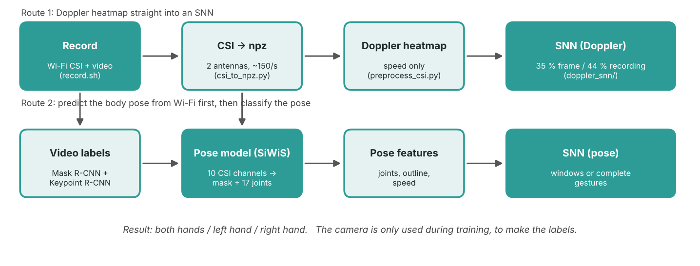
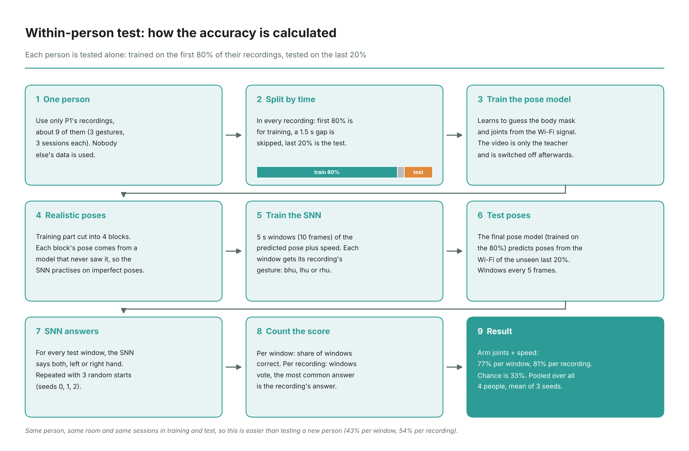

# Workflow in detail

This page follows the data from the router to the final answer. Each stage names the file that does it, the folder it writes to
(default root `~/percom`, see `scripts/env.sh`) and the idea behind it.

## 0. Recording (`collection/`)

| | |
|---|---|
| program | `record.sh` |
| input | the Wi-Fi card (PicoScenes) and the webcam |
| output | `~/percom/experiment_<date>_<time>/` with `video.mp4`, `timing.txt`, `rx_*.csi`, logs |

* PicoScenes only logs packets that arrive, so the script pings the router every 2 ms to produce a steady stream.
* PicoScenes starts first (t = 0), the video 10 s later. Both start times (epoch seconds) go to `timing.txt`. They are the
  only link between video and CSI later on.
* If no `.csi` file appears, `csi_check.sh` tests the usual causes (laptop not connected, traffic going through Ethernet,
  PicoScenes listening on a different channel than the router) and re-tunes the card if needed.

## 1. From `.csi` to a Doppler heatmap (`csi_tools/`)

1. `csi_to_npz.py`: reads the PicoScenes frames, keeps the two receive antennas of the same transmitted stream, drops null tones,
   thins the stream to about 150 packets per second and stores `data` (complex), `t` (packet times) and `t0_epoch`.
2. `preprocess_csi.py`:
   1. antenna A / antenna B per tone (cancels most hardware noise), with a vote over the first packets to find tones with phase outliers;
   2. a second division between neighbouring tones (removes leftover offsets);
   3. values above 5× the typical level are treated as errors and clipped, then Savitzky–Golay smoothing;
   4. interpolation onto an even grid of 100 samples per second (the packets arrive irregularly because of the ping traffic);
   5. 0.5 s Hann windows, still background removed, FFT over time (100 bins), power summed over tones;
   6. a *motion* curve (energy above 1.5 Hz) is saved too, and a moment counts as movement when it is above 3 % of the recording's peak.
3. `csi_video_sync.py`: shows the result next to the video. We used it to check by eye that spectrogram and video line up.

## 2. Experiment 1: Doppler → SNN (`doppler_snn/`)

* `make_dataset.py` runs steps 1 to 2 for every recording on the SSD and cuts 1 s frames every 0.5 s. A frame gets the gesture of its recording.
  Frames with dead signal get `valid = 0` and are skipped in training.
* `train_snn.py --mode loso`: train on two people, pick the best epoch on a third (validation), test on the fourth, repeat so that every person is the test person once.
  Reported per frame and per recording (majority vote of its frames), averaged over the four test people.

## 3. Pose labels and features (`siwis_pose/prepare_percom.py`)

* Video: decoded at 2 frames per second, resized to 480 px height, passed through Mask R-CNN (person mask, score ≥ 0.5) and
  Keypoint R-CNN (17 joints, person detection score ≥ 0.7, joint visible if its score > 1.0). Frames without a clearly detected person are dropped.
  Mask and joints are resized to 48 × 64; each joint becomes a Gaussian dot (σ = 2) on its own heatmap.
* CSI: two streams (amplitude spread per antenna) at 150 Hz, later extended to ten channels by `train_percom_v2.py` (see below).
* A frame at time *t* uses the 1.7 s (255 samples) of CSI that end at *t*.
* Clock check: video length versus CSI length versus `timing.txt`. A recording that looks shifted by more than a few seconds is reported.

## 4. Pose model (SiWiS)

`train_percom.py` (earlier) and `train_percom_v2.py` (final) train the instructor's `SiWiSNet`, which predicts a 48 × 64 body mask and 17 joint heatmaps from the CSI window.
Why a second version: in the repository's loss the mask error is summed over all pixels (thousands) while the joint error is a mean (about 0.002), so the joints barely trained.
The final version divides the mask loss by the number of pixels and multiplies the joint loss by 500, and uses the ten channels:

| # | channel |
|---|---|
| 2 | spread of the amplitude across subcarriers, per antenna |
| 2 | log of the mean amplitude, per antenna |
| 1 | phase difference between the antennas |
| 1 | angle of arrival estimated from that phase difference |
| 2 | speed of the angle of arrival and its spread over 0.5 s |
| 2 | speed of the log amplitude, per antenna |

Every channel is z-scored inside its own recording (no labels used).

## 5. SNN on the predicted pose

`pose_snn.py` (cross-person) and the SNN part of `within_pipeline.py` / `segment_pipeline.py` use the same idea: per frame a vector of
192 numbers (outline pooled to 12 × 16), 36 numbers (shoulders, elbows, wrists: peak position, soft position, peak height, wrist–elbow and wrist–shoulder offsets) or both (228). "Speed" appends the change from one frame to the next, which doubles the size.
The recording's average pose is subtracted first, and the values are scaled with the statistics of the training people only.

## 6. Within-person and complete gestures

* `within_pipeline.py`: per person, first 80 % of every recording trains, last 20 % tests, 3 frames dropped in between. The pose model predicts the training part *out-of-fold*
  (4 contiguous blocks, each predicted by a model trained on the other blocks, with a 3-frame gap on each side), and a final model trained on the whole 80 % predicts the test part.
  The SNN reads 10-frame windows (train stride 2, test stride 5), three seeds. A window can cut through a gesture, which is the main limitation of this version.
* `video_segments.py`: Keypoint R-CNN at 10 fps on the raw video. For every frame: (elbow height − wrist height) / torso height, per hand.
  Each peak of this curve is a raised hand; the valleys on both sides are the cut points. Cut times are transferred to the label frames, and thereby to the CSI, with the time stamps.
* `segment_pipeline.py`: the same chain, but the unit is one complete gesture (~2.5 s). Segments are split in time order (about 80 % train, one segment dropped, about 20 % test).
  The SNN reads one step per label frame (0.5 s) and averages its read-out over all real frames, so gestures of different lengths work.
  `--control` repeats the SNN with poses from the video, to show that the SNN itself works.

